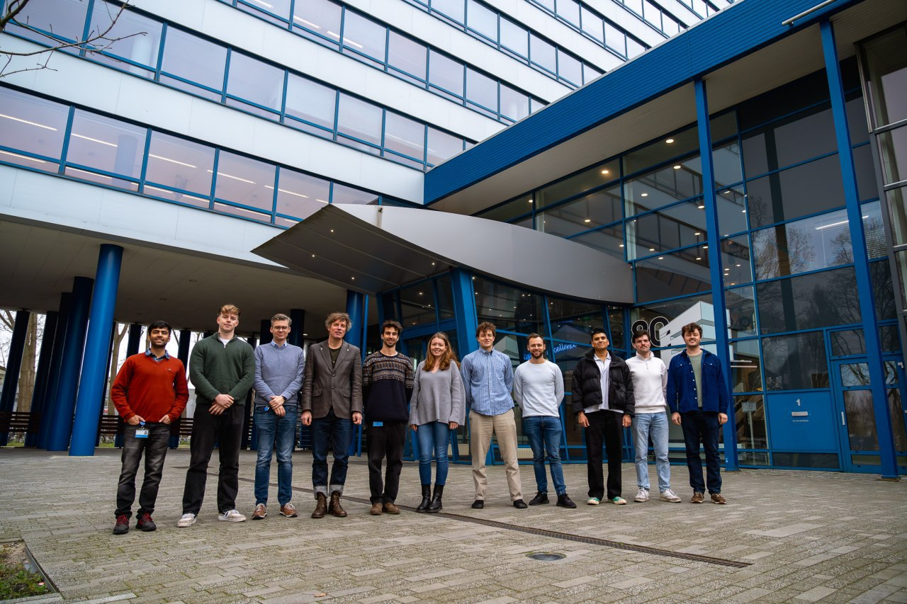
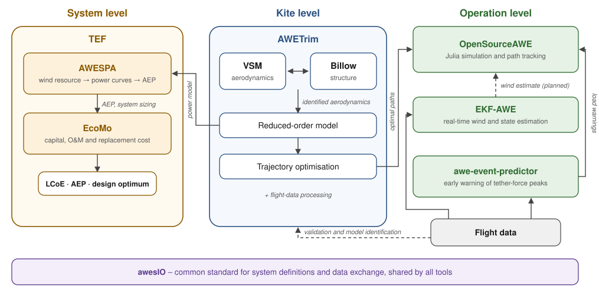

## Welcome to the TU Delft Airborne Wind Energy group on GitHub!

Here you can find the open-source code and data behind our research. Most of the work is linked to
publications that can be found through the [TU Delft Repository](https://repository.tudelft.nl/).

## Open-source toolchain for soft-kite systems

Our tools for soft-wing (leading-edge inflatable) kite power systems work together across three levels:
the **system** (cost and energy yield), the **kite** (aerodynamics, structure and flight paths) and its
**operation** (simulation, estimation and early warning). The tools exchange system definitions and data
through the common [awesIO](https://github.com/awegroup/awesIO) standard.

  <picture>
    <source media="(prefers-color-scheme: dark)" srcset="soft_kite_toolchain_dark.svg">
    
  </picture>

| Level | Tool | What it does |
|---|---|---|
| System | [TEF](https://github.com/awegroup/TEF) | Techno-economic framework: sizes the system and finds the design with the lowest cost of energy |
| System | [AWESPA](https://github.com/awegroup/AWESPA) | Wind resource, power curves and annual energy production |
| System | [EcoMo](https://github.com/awegroup/EcoMo) | Economic model: capital, operation and maintenance, replacement cost and LCoE |
| Kite | [AWETrim](https://github.com/awegroup/AWETrim) | Quasi-steady kite simulation: aero-structural trim, reduced-order models and trajectory optimisation |
| Kite | [Vortex-Step-Method](https://github.com/awegroup/Vortex-Step-Method) | Fast aerodynamics of curved, deforming wings |
| Kite | [Billow](https://github.com/awegroup/Billow) | Structural model of soft inflatable kites: tubes, wrinkling canopy and bridle lines |
| Operation | [OpenSourceAWE](https://github.com/OpenSourceAWE) | Julia ecosystem for dynamic simulation and control of kite power systems |
| Operation | [EKF-AWE](https://github.com/awegroup/EKF-AWE) | Extended Kalman filter: the kite as a wind and state sensor |
| Operation | [awe-event-predictor](https://github.com/awegroup/awe-event-predictor) | Machine-learning early warning of critical tether-force peaks |

<b>Open data: soft kites</b> (7 datasets)

| Dataset | Kite | Flight |
|---|---|---|
| [TUDELFT_V3_KITE](https://github.com/awegroup/TUDELFT_V3_KITE) | TU Delft V3, 25 m² | Geometry, specifications and analyses |
| [Flightdata24032017](https://github.com/awegroup/Flightdata24032017) | TU Delft V3, 25 m² | 24 March 2017, ten pumping cycles with an onboard flow sensor |
| [Flightdata08102019](https://github.com/awegroup/Flightdata08102019) | TU Delft V3, 25 m² | 8 October 2019 |
| [Flightdata12052023](https://github.com/awegroup/Flightdata12052023) | Kitepower V9, 60 m² | 12 May 2023, Dirksland, the Netherlands |
| [Flightdata27112023](https://github.com/awegroup/Flightdata27112023) | Kitepower V9, 60 m² | 27 November 2023, Bangor Erris, Ireland |
| [Flightdata05062024](https://github.com/awegroup/Flightdata05062024) | Kitepower V9, 60 m² | 5 June 2024, Bangor Erris, Ireland |
| [Flightdata09102025](https://github.com/awegroup/Flightdata09102025) | TU Delft V3, 25 m² | 9 October 2025, Bangor Erris, with photogrammetry of the flying shape |

## Rigid-wing systems

*Full overview coming soon.*

| Tool | What it does |
|---|---|
| [MegAWES](https://github.com/awegroup/MegAWES) | Matlab/Simulink model of a multi-megawatt rigid-wing pumping system, 3DoF and 6DoF dynamics |
| [AWE-SE](https://github.com/awegroup/AWE-SE) | Systems-engineering framework for design and scaling of fixed-wing ground-generation systems, coupling AWE-Power and AWE-Eco (MATLAB) |
| [AWE-Power](https://github.com/awegroup/AWE-Power) | Quasi-steady cycle-power model of fixed-wing ground-generation systems (MATLAB) |
| [AWE-Eco](https://github.com/awegroup/AWE-Eco) | Reference economic model for AWE systems, IEA Wind Task 48 (MATLAB) |

<b>Open data: rigid wings</b> (2 datasets)

| Dataset | System | Flight |
|---|---|---|
| [ampyx-ap2-flightdata](https://github.com/awegroup/ampyx-ap2-flightdata) | Ampyx Power AP2 | 3 October 2017 |
| [Flightdata2022-Kitemill](https://github.com/awegroup/Flightdata2022-Kitemill) | Kitemill | 29 March – 28 April 2022 |

## Learn more about airborne wind energy

- [The lecture notes](https://awecourse.github.io/slides/) from Roland Schmehl's MSc course at the AE Faculty of the TU Delft.
- [Airborne Wind Europe](https://airbornewindeurope.org/) for more general information.
- [The white paper](https://airbornewindeurope.org/wp-content/uploads/2023/03/BVGA-Getting-Airborne-White-Paper-220929.pdf) written with many prominent people in the industry and BVG Associates.
